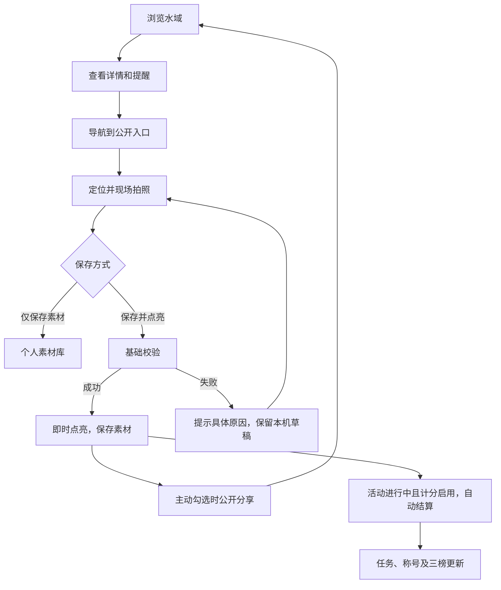

# 当前功能说明（2026-10-13）

## 已确认的范围变化

1. 本阶段取消出钓人工审核，提交成功即点亮，不出现待审 / 驳回步骤。
2. 贵州主题和第一季时间保留，**贵州坐标范围限制延后，当前没有省界拦截**。不能将现版本描述为已限制贵州。
3. 无初始化点亮或示例用户数据；水域基础档案由管理员录入或采纳申请建立。
4. 数据库、高德、天气可后配；未配置状态可见。
5. 首期主线为找水域、分享鱼获、收集个人素材，并配套活动看板。

## 主流程

## 四个用户入口

### 找钓位

搜索水域 / 地区；筛选全部、已点亮、我的点亮、待探、本季任务、管理员推荐。地图下方直接显示水域列表；取得用户定位后按水域代表点距离由近到远排序并显示距离，定位不可用时保留原始顺序和明确提示。地图没有 Key 时展示明确占位与装饰纹理，真实水域列表仍可使用。水域详情包括鱼种汇总、近期人数、有效记录、公开分享和提醒；未维护公开入口时禁用导航。导航仅使用管理员维护的公开入口，不使用其他钓友下竿坐标。

热度按不同钓友数统计，后台可配置天数和人数阈值。鱼获数据仅从主动公开的记录汇总。首版“火热”表示近期不同贡献人数达到阈值，不声称是鱼获预测或已实现独立鱼获热度模型。禁钓 / 水源提醒不阻断点亮。

### 我要点亮

支持定位、选水域、现场拍环境照、有鱼获 / 空军 / 探路、鱼种多选、笔记和公开选项。点亮要求现场环境图及定位；有鱼获时还要求现场鱼获照。相册可导入私人素材，不能代替现场环境证据。

定位最长保留 24 小时，允许弱网现场记录后补交；误差超过 1 公里需重新定位。所选水域中心距离定位超过 20 公里会提示重新确认，这是粗略错选检查，**不是省界校验，也不是 2 公里覆盖半径**。大型水域后续应使用多边形判断。

相机只由用户主动开启，关闭浮层或离开记录页后释放相机。照片及表单缓存在 IndexedDB 中，按当前账号隔离；这是本机草稿，不是跨设备云备份。上传重试沿用已上传素材编号；同一请求 UUID 重复提交不生成重复记录或积分。

### 我的素材

按出钓归档，支持按日期 / 水域 / 鱼种 / 笔记搜索，筛选点亮、私密、分享和撤销记录。可下载收到的原文件、切换公开范围、生成分享卡、撤销记录。照片原文件只允许本人和管理员读取，公开接口只提供去元数据的缩略图。

分享卡包含首图、水域名称、日期、鱼种，不写入系统定位或私人笔记；生成前需用户确认照片内容。支持系统文件分享时调用系统分享，否则下载卡片。不会自动把私人记录变成公开记录。页面对话框 / 分享调用仍需不同手机真机验证。

### 活动看板

赛季信息、未开始 / 进行中 / 已结束、个人积分、水域数、积分排名、称号、三项任务、三榜、积分明细、奖励说明和公示中心。数据来自真实记录，不生成虚假榜单。

三榜首版口径：积分榜按有效积分；探水榜按本季不同归属水域；拓荒榜按本季最早有效归属记录事件，与奖励分值独立。排序同分按稳定用户 ID，界面明确显示。默认分值为**配置草案**：基础 10、现场鱼获 5、入门 5、首亮 20、每周 3 处不同水域奖励 10；计分默认关闭，运营确认后启用。首亮奖励为零时，拓荒榜仍统计有效首亮水域。

周常按北京时间周一开始，完成时自动结算。计分采用提交服务器时间（私人记录后续点亮时使用点亮时间），不依赖可修改的设备时钟。赛季外普通点亮可用，不计本季分。规则使用记录快照，新配置不追改既有记录。首亮为该水域最早有效归属记录；赛季前已有有效首亮的水域不再成为本季拓荒。

## 2 公里影响范围

有效记录保存半径 2000 米，公共端不返回精确圆心。首版用“水域代表点落在提交位置 2 公里范围内”更新邻近水域聚合，并保证归属水域计入有效贡献；个人探水数和积分只归属用户选定的水域。尚未做水域多边形交集、面状覆盖裁剪或精确网格热力图，后续接入水域边界后替换空间实现。

## 新水域闭环

用户可关联自己的定位记录提交申请。管理员采纳为新水域、关联已有水域或填写原因不采纳。采纳后关联原素材，不自动补发活动积分；用户可在素材详情“点亮这次记录”，仍需满足现场图、定位时效等基础要求。超过时效可保留素材，再次出钓提交。此处是档案采纳，不是恢复出钓审核。

## 撤销闭环

本人或管理员填写原因撤销记录，逻辑删除公开贡献，私人素材保留在撤销记录中。积分、任务、称号、榜单和聚合热度以有效数据重新计算；唯一有效贡献撤销后熄灭，其他贡献保留，首亮归属顺延。审计日志保留操作人、对象、原因与时间。首版积分明细展示有效结果及审计日志，尚未提供逐笔冲正账单页面。

## 建议验收

- 空数据启动：无水域、无照片、无榜单，四个入口可访问。
- 管理员新增真实水域及公开入口，游客可搜索并导航。
- 空军现场拍环境图后立即点亮，无审核等待。
- 有鱼获增加鱼获图，选择鱼种，按用户意愿分享。
- 相册图片可保存；单独使用相册图点亮被拒绝。
- 关闭分享不影响点亮；匿名无法读取私密照片和原图。
- 重复提交不重复加分；相同图像不能再次用于点亮。
- 管理员撤销后成绩和地图重算，私人素材仍可查看。
- 无高德 / 天气时明确提示，不伪造外部数据。
